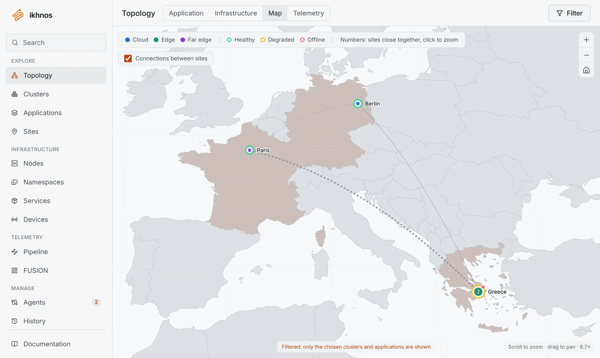
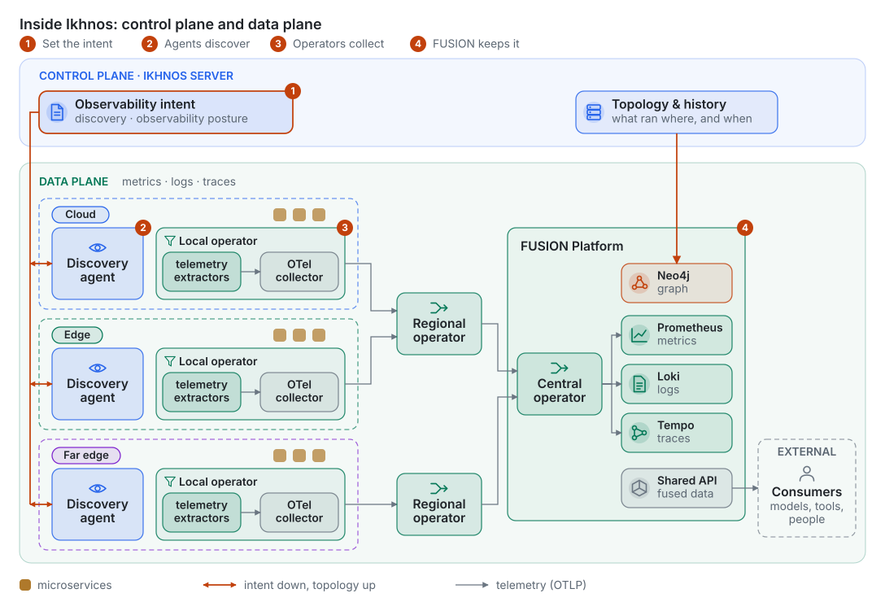

<p align="center">
  <picture>
    <source media="(prefers-color-scheme: dark)" srcset="public/brand/primary/ikhnos-dark.svg">
    
  </picture>
</p>

<h3 align="center">See everything, touch nothing.</h3>

<p align="center">Observability across the cloud–edge computing continuum: topology discovery and telemetry collection for your Kubernetes clusters, driven by an observability intent.</p>

<p align="center">
  <a href="https://github.com/alexandrosst/ikhnos/actions/workflows/ci.yml"></a>
  <a href="https://alexandrosst.github.io/ikhnos/"></a>
  <a href="LICENSE"></a>
  <a href="backend/go.mod"></a>
  <a href="https://github.com/alexandrosst/ikhnos/actions/workflows/docs.yml"></a>
  
  
  
</p>

<p align="center">
  <a href="https://alexandrosst.github.io/ikhnos/docs/getting-started/quickstart"><b>Quickstart</b></a> ·
  <a href="https://alexandrosst.github.io/ikhnos/">Documentation</a> ·
  <a href="https://alexandrosst.github.io/ikhnos/docs/journey/">Your first hour</a> ·
  <a href="https://alexandrosst.github.io/ikhnos/docs/inside/">How it is built</a> ·
  <a href="https://alexandrosst.github.io/ikhnos/docs/project/roadmap">Roadmap</a> ·
  <a href="CONTRIBUTING.md">Contributing</a>
</p>

<p align="center">
  <sub>Developed at</sub><br>
  <a href="https://www.netmode.ntua.gr/">
    <picture>
      <source media="(prefers-color-scheme: dark)" srcset="docs-site/static/img/readme/netmode-dark.svg">
      
    </picture>
  </a>
</p>

<p align="center">
  <picture>
    <source media="(prefers-color-scheme: dark)" srcset="docs-site/static/img/readme/topology-loop-dark.webp">
    
  </picture>
  <br>
  <sub>The built-in sample landscape, placed in Berlin, Paris and Athens (made-up clusters, not real infrastructure). The dashes move with the traffic between sites.</sub>
</p>

- **One command per cluster.** Run it, approve the cluster, and it appears. No kubeconfig is handed over, and the server never connects into a cluster.
- **Read-only by design.** A small agent looks. It cannot change your workloads or read your Secrets.
- **You decide how far it looks.** That is your [observability intent](https://alexandrosst.github.io/ikhnos/docs/learn/observability-intent): per cluster, from "registered only" up to services, and it can only be narrowed, never widened. It covers telemetry too, so metrics, logs and traces are opt-in, one signal at a time.

## What it is

Ikhnos (ἴχνος) is Greek for "trace" or "footprint". It provides visibility across the cloud-edge continuum, revealing where workloads run and how they communicate.

It shows Kubernetes clusters, from cloud to edge and far edge, as one picture: an **application view** (services and the dependencies between them) and an **infrastructure view** (nodes, capacity, links). A small read-only **agent** in each cluster dials out to a single **server** and reports what it sees. How far it looks is your [observability intent](https://alexandrosst.github.io/ikhnos/docs/learn/observability-intent). On top of that sit history, measured links between clusters, and telemetry you can read in Grafana, collected under the same intent.

## Design principles

Ikhnos is meant to be pointed at clusters that matter, so these are rules the code and the Helm chart enforce, not promises. [The trust model](https://alexandrosst.github.io/ikhnos/docs/architecture/trust-model) shows where each one is held.

| Principle | What it means |
|---|---|
| **Read-only** | The agent reads the Kubernetes API (`get`, `list`, `watch`) and never reads your Secrets or ConfigMaps. Its only writes are three narrow ones, to its own identity, the certificates it renews and the status of its own resource. Ikhnos never deploys or moves your workloads. |
| **Outbound only** | The agent opens every connection to the server, over mutual TLS. The server needs no route into a cluster and never holds a kubeconfig. |
| **Narrow, never widen** | The [observability intent](https://alexandrosst.github.io/ikhnos/docs/learn/observability-intent) sets how far each part may look, per cluster and per signal. Each layer can narrow it and none can widen it. Telemetry stays off until you turn a signal on. |
| **You run the changes** | Ikhnos generates the `helm` commands and you run them. The one exception, an optional controller inside the cluster, is off until you turn it on. |
| **Honest data** | What was seen is shown as seen, what was declared as declared, what was guessed as a guess, and missing data is named. |
| **Accountable** | A person's changes are recorded with who made them, and history keeps what the landscape looked like before. |

## Features

- **Observability intent.** One setting for everything that looks at a cluster: the discovery agent, the local operators that collect telemetry and the regional operators that gather it. You set it per cluster and per signal, and it can only be narrowed.
- **Topology.** Application, Infrastructure, Map and Telemetry views of the same landscape, with clusters tiered cloud, edge or far edge. Plus Clusters, Applications, Sites, Nodes, Namespaces, Services and Devices as tables.
- **Discovery that asks first.** Connect a cluster from the UI: it prints the exact `helm install`, and an approval code that only the cluster's own pod log shows turns "someone had a token" into "this is the agent I meant".
- **History.** Every change to anything is a new version with a reason attached. Ask what a cluster looked like an hour ago, or what depends on a service.
- **Telemetry and FUSION.** Opt-in collectors, regional operators and a bundled Prometheus, Loki, Tempo and Grafana stack with nine dashboards, from the fleet down to a single workload and Ikhnos' own health, opened through the server so nothing is exposed.
- **Cluster links.** Loss, delay and jitter between clusters you choose to pair, from real traffic and active measurement. The paired clusters must be able to reach each other.
- **Diagnose.** One button per agent explains what is wrong with it, worst first, with the `kubectl` command for each finding.
- **Accounts.** Roles, two-factor sign-in (TOTP, email code, passkeys) and an audit trail.
- **Open interfaces.** A JSON API behind the UI and a token-protected FUSION API with its own reference page.

## How it works

<p align="center">
  <picture>
    <source media="(prefers-color-scheme: dark)" srcset="docs-site/static/img/readme/observability-intent-dark.svg">
    
  </picture>
</p>

Ikhnos has two planes. The **control plane** is the server. It holds your [observability intent](https://alexandrosst.github.io/ikhnos/docs/learn/observability-intent), which sets what to observe and where, and it keeps the topology and its history. A read-only **discovery agent** in each cluster dials out to it, applies the intent itself and reports what it finds.

The **data plane** carries telemetry and nothing else. A **local operator** in each cluster collects the signals you chose and sends them on, straight to FUSION or through a **regional operator** that gathers several clusters. **FUSION** keeps metrics, logs and traces, with Grafana beside them, behind one shared API. The API reads the topology from the server when a question needs it.

The observability intent is one idea for every part that looks at a cluster. It sets:

- **For the discovery agent:** how much of the cluster it reads (from "registered only" up to services), which optional collectors run, and which namespaces it leaves out.
- **For the local operator:** which signals it collects (metrics, logs, traces), for which namespaces, and where it sends them.
- **For a regional operator:** which clusters it may accept data from, and where it passes it on.

Whatever the part, it is said in the same terms:

- **Layer**: application or infrastructure.
- **Scope**: an application, a cluster or a node.
- **Modality**: traces, logs or metrics.
- **Kind**: the signal itself, eleven in all:
  - metrics: resource usage, energy, accelerators (GPU), Kubernetes state, node runtime, cluster links, application metrics
  - logs: system logs, Kubernetes events, application logs
  - traces: application traces

It can only be narrowed, never widened, and a person approves anything wider. The agent discovers the topology and configures collection: telemetry extractors feed the local operator's collector, and regional collectors feed FUSION.

The documentation goes into each part: [how it works in ten minutes](https://alexandrosst.github.io/ikhnos/docs/learn/how-it-works) for the idea, and [Inside Ikhnos](https://alexandrosst.github.io/ikhnos/docs/inside/) for the server's layers, the agent's stream and the model.

## Quickstart

You need a Kubernetes cluster (1.25 or newer; k3s, kind and minikube are fine for a trial), `kubectl`, and Helm 3.8 or newer. Releases are published to this repository's own GitHub Container Registry, so there is nothing to build.

```bash
# 1. An address your agents can reach (one EXTERNAL-IP, or an INTERNAL-IP for a trial)
kubectl get nodes -o wide

# 2. Install the server (replace NODE_IP; on a cloud with load balancers see the production guide)
helm install ikhnos-server oci://ghcr.io/alexandrosst/ikhnos-server \
  --namespace ikhnos --create-namespace \
  --set agent.service.type=NodePort \
  --set agent.publicAddress=NODE_IP:30443

# 3. Wait for the pod (Ctrl+C when it is 1/1 Running), then read the first admin password (printed once)
kubectl -n ikhnos get pods -w
kubectl -n ikhnos logs deployment/ikhnos-server | grep -A2 'First start'

# 4. Open the UI
kubectl -n ikhnos port-forward service/ikhnos-server 8080:8080   # https://localhost:8080
```

Sign in as `admin`, choose a real password, name your organisation, then use **Connect a cluster**: it prints the `helm install` for the agent with its token and the server's CA pin already filled in. Copy the sealing key the chart made out of the cluster (the install notes print the command); it protects the secrets stored in the server's database. The full walk-through, including a load balancer or Gateway for real use, is in the [quickstart](https://alexandrosst.github.io/ikhnos/docs/getting-started/quickstart) and the [production guide](https://alexandrosst.github.io/ikhnos/docs/installation/production-cluster).

**Just want to look around?** The UI runs on its own, with a made-up cloud, edge and far-edge landscape and no server:

```bash
git clone https://github.com/alexandrosst/ikhnos.git && cd ikhnos
npm install && npm run dev        # http://localhost:5173
```

## Documentation

The [documentation site](https://alexandrosst.github.io/ikhnos/) is written for three readers. Its sources are in [`docs-site/docs`](docs-site/docs) and read fine on GitHub.

| I am... | Start with |
|---|---|
| New to Ikhnos and want to know what it is | [What is Ikhnos?](https://alexandrosst.github.io/ikhnos/docs/learn/what-is-ikhnos), then [How it works in ten minutes](https://alexandrosst.github.io/ikhnos/docs/learn/how-it-works) |
| Ready to try it, and have never seen it | [Your first hour](https://alexandrosst.github.io/ikhnos/docs/journey/): six steps from nothing to a connected cluster and your first look around, with what you should see after each |
| Running it for real | [Production cluster](https://alexandrosst.github.io/ikhnos/docs/installation/production-cluster), [Connecting a cluster](https://alexandrosst.github.io/ikhnos/docs/installation/connecting-a-cluster), [Troubleshooting](https://alexandrosst.github.io/ikhnos/docs/troubleshooting/common-errors) |
| Looking something up | [Using the interface](https://alexandrosst.github.io/ikhnos/docs/user-guide/using-the-ui), [Reference](https://alexandrosst.github.io/ikhnos/docs/reference/): Helm values, flags and the permissions table |
| Reading or changing the code | [Inside Ikhnos](https://alexandrosst.github.io/ikhnos/docs/inside/), then the [developer guide](https://alexandrosst.github.io/ikhnos/docs/contributing/developer-guide) |
| Deciding whether to depend on it | [Status and limits](https://alexandrosst.github.io/ikhnos/docs/project/status-and-limits) and the [roadmap](https://alexandrosst.github.io/ikhnos/docs/project/roadmap) |

## Status

Ikhnos is **pre-1.0**. It discovers and shows; it never deploys or moves anything. It has been tested end to end on k3s, with real eBPF programs against real loopback traffic, and under `-race`. It has **not** been run on a production cluster, with two live clusters, or against a running service mesh; EKS, GKE and AKS are expected to work and untested.

The full, itemised account of what was and was not verified, and what is not built (OIDC, ambient-mesh attribution and more), is on [Status and limits](https://alexandrosst.github.io/ikhnos/docs/project/status-and-limits). Please read it before depending on this.

## Contributing

Issues and pull requests are welcome. [CONTRIBUTING.md](CONTRIBUTING.md) has the short version; the [developer guide](https://alexandrosst.github.io/ikhnos/docs/contributing/developer-guide) has the rest.

```bash
npm install && npm run lint && npm run test:unit && npm run test:ui && npm run build   # frontend
cd backend && go vet ./... && go test -race ./...                                        # backend
```

```
src/             React 19 + TypeScript + Tailwind 4 frontend (Vite, React Flow, Zustand)
backend/         Go module "ikhnos": server, agent, node probe, traffic observer, controller, CLI
backend/docs/    Code-adjacent references: the model API, the twin, the decision loop and advice
deploy/          Helm charts (server, controller), backup notes, policies
docs-site/       The documentation site (Docusaurus)
```

## Security

Releases are signed with cosign, keylessly. Please report a vulnerability privately through GitHub's *Security → Report a vulnerability*, not in a public issue; see [SECURITY.md](SECURITY.md).

## License

[Apache License 2.0](LICENSE). Dependencies were checked for compatibility. The copyleft pieces are separate programs that the server only talks to over the network: Neo4j Community Edition (GPLv3), the server's graph store (`neo4j.mode: external` is for running your own, see [`deploy/README.md`](deploy/README.md#neo4j)), and, only if you turn FUSION on, Grafana, Loki and Tempo (AGPLv3).

<details>
<summary>Third-party data</summary>

- City names and coordinates: [GeoNames](https://www.geonames.org/) `cities15000`, CC BY 4.0 (rebuild with `scripts/build-geodata.py`).
- Country outlines: Natural Earth via `world-atlas` (public domain).
- IP geolocation, optional and supplied by you: [DB-IP.com](https://db-ip.com) (CC BY 4.0) or MaxMind GeoLite2, under its own license.
- The footer's owner, year and license name are set in `src/components/ui/brand.tsx`.

</details>
